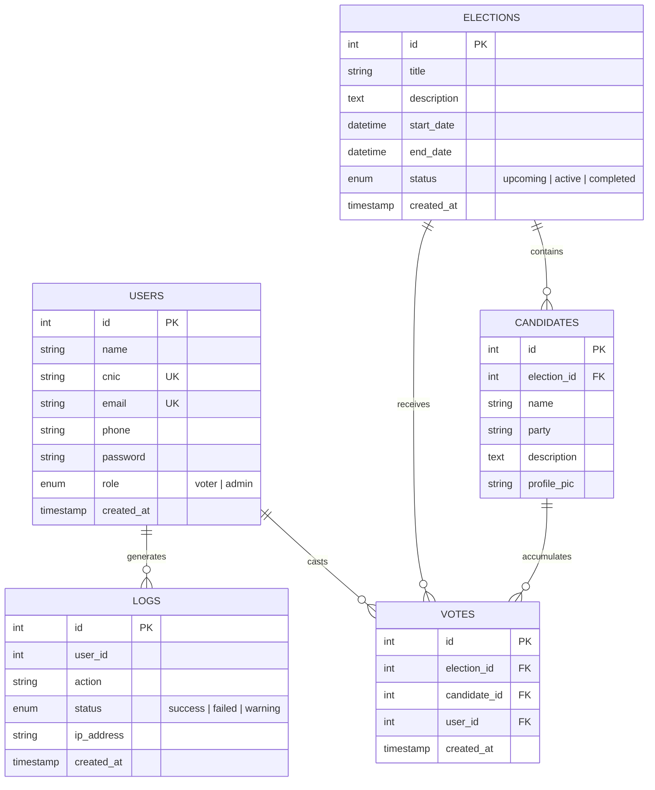

# 🗳️ VoteSphere — Smart Digital E-Voting Platform

[](https://www.php.net/)
[](https://www.mysql.com/)
[](https://developer.mozilla.org/en-US/docs/Web/JavaScript)
[](https://developer.mozilla.org/en-US/docs/Web/CSS)
[](https://www.chartjs.org/)
[](https://opensource.org/licenses/MIT)

> **VoteSphere** is a modern, tamper-resistant, web-based digital voting and election management system designed to make electoral processes transparent, secure, and accessible. Built with a sleek dark-mode glassmorphic interface, PDO-secured REST APIs, and real-time visualization dashboards.

---

## Table of Contents

- [Key Features](#-key-features)
- [System Architecture](#-system-architecture)
- [Technology Stack](#-technology-stack)
- [Project Directory Structure](#-project-directory-structure)
- [Database Schema & Architecture](#-database-schema--architecture)
- [Installation & Setup Guide](#-installation--setup-guide)
- [Demo Credentials](#-demo-credentials)
- [API Endpoints Reference](#-api-endpoints-reference)
- [Security & Integrity Mechanisms](#-security--integrity-mechanisms)
- [License](#-license)

---

## Key Features

### Voter Portal
- **Identity-Verified Authentication:** Voter registration and login validated via CNIC (National Identity Card) and email.
- **Interactive Digital Ballot:** Smooth 3D tilt candidate selection cards with visual confirmation and tactile feedback.
- **Strict One-Person-One-Vote Rule:** Database-enforced composite unique constraint prevents double-voting across elections.
- **Personal Voter Dashboard:** Track election status, view voting history, and verify cast ballot confirmation.

### Admin Command Center
- **System KPI Metrics:** Live statistics displaying total registered voters, active contests, and turnout rates.
- **Election Lifecycle Management:** Schedule, launch, monitor, and conclude elections seamlessly.
- **Candidate Administration:** Register candidates, associate them with parties, set bios, and upload candidate portraits.
- **Audit & Activity Logs:** Comprehensive tracking of logins, administrative events, and voting operations with IP tagging.

### Real-Time Analytics & Results
- **Live Visual Data:** Dynamic charts powered by [Chart.js](https://www.chartjs.org/) (Bar charts and Doughnut distribution).
- **Instant Tallying:** Results calculate live from verified ballots once elections conclude or during active monitoring.
- **Public & Transparent:** Results viewable with breakdown percentages and candidate standing.

---

## System Architecture

VoteSphere follows a modular client-server RESTful pattern:

```text
┌────────────────────────────────────────────────────────┐
│                      Client Layer                      │
│   Vanilla JS (ES6+), Fetch API, SweetAlert2, Chart.js  │
│          Modern Glassmorphism UI (CSS3 Grid/Flex)      │
└───────────────────────────▲────────────────────────────┘
                            │ (JSON over HTTP)
┌───────────────────────────▼────────────────────────────┐
│                    PHP REST API Layer                  │
│       api/auth/  │  api/elections/  │  api/votes/      │
│            Object-Oriented PDO Database Layer          │
└───────────────────────────▲────────────────────────────┘
                            │ (Prepared Statements)
┌───────────────────────────▼────────────────────────────┐
│                   MySQL / MariaDB                      │
│       users  │  elections  │  candidates  │  votes     │
└────────────────────────────────────────────────────────┘
```

---

## Technology Stack

| Layer | Technologies Used |
| :--- | :--- |
| **Frontend** | HTML5, CSS3 (Modern Glassmorphic Dark Theme, 3D Tilt), JavaScript (ES6+) |
| **Backend** | PHP 7.4 / 8.x (RESTful Endpoints, PDO Object-Oriented Architecture) |
| **Database** | MySQL / MariaDB (Relational schema with strict foreign keys & unique keys) |
| **UI & Icons** | [Outfit Font](https://fonts.google.com/specimen/Outfit), [FontAwesome 6](https://fontawesome.com/), [SweetAlert2](https://sweetalert2.github.io/) |
| **Data Viz** | [Chart.js](https://www.chartjs.org/) |

---

## Project Directory Structure

```text
Vote/
├── .gitignore                   # Excludes database dumps, credentials, and logs
├── README.md                    # Project documentation & setup manual
├── admin.php                    # Administrator control panel
├── dashboard.php                # Voter personal dashboard
├── database.sql                 # SQL schema definitions & sample seed data (Git ignored)
├── footer.php                   # Global template footer
├── header.php                   # Global template header & navigation bar
├── index.php                    # Public landing page with features & hero section
├── login.php                    # Secure user authentication portal
├── register.php                 # Voter registration with CNIC validation
├── results.php                  # Interactive visual election results page
├── voting.php                   # Digital ballot casting interface
│
├── api/                         # Backend REST API services
│   ├── auth/
│   │   ├── login.php            # User authentication endpoint
│   │   └── register.php         # User onboarding endpoint
│   ├── candidates/
│   │   └── read.php             # Fetch candidates by election
│   ├── config/
│   │   └── Database.php         # PDO Database singleton connection wrapper
│   ├── elections/
│   │   ├── create.php           # Admin endpoint: Create new election
│   │   ├── delete.php           # Admin endpoint: Remove election
│   │   └── read.php             # Retrieve active, upcoming, or past elections
│   ├── users/                   # User profile and management endpoints
│   └── votes/
│       ├── cast.php             # Secure ballot submission handler
│       └── results.php          # Aggregate vote totals and statistics
│
├── css/
│   └── style.css                # Dark-mode styling, glassmorphism, animations
├── js/
│   └── app.js                   # Client-side state, auth checks, API bindings
└── images/                      # Image assets & candidate profile pictures
```

---

## Database Schema & Architecture

The relational schema ensures ACID compliance, ballot confidentiality, and duplicate vote rejection.



### Table Definitions
- **`users`**: Stores voter and administrator records. CNIC and email are indexed with `UNIQUE` constraints. Passwords stored using `password_hash()` (bcrypt).
- **`elections`**: Houses election contests, descriptions, scheduling windows, and status flags.
- **`candidates`**: Linked to elections with cascading foreign keys (`ON DELETE CASCADE`).
- **`votes`**: Enforces `UNIQUE KEY one_vote_per_user (election_id, user_id)` — strictly preventing multiple votes per voter per election.
- **`logs`**: Immutable audit log for recording system activity, logins, and voting attempts.

---

## Installation & Setup Guide

### 1. Prerequisites
Ensure you have the following installed on your machine:
- [XAMPP](https://www.apachefriends.org/) (or WampServer / LAMP / LEMP with PHP 7.4+ and MySQL 5.7+)
- Web browser (Chrome, Edge, Firefox, or Safari)
- Git (optional, for version control)

### 2. Clone or Move Project to Web Server Directory
Place this project inside your web server's root folder:
- **XAMPP on Windows:** `C:\xampp\htdocs\Vote`
- **XAMPP on macOS / Linux:** `/opt/lampp/htdocs/Vote` or `/var/www/html/Vote`

```bash
git clone https://github.com/<your-username>/VoteSphere.git C:\xampp\htdocs\Vote
```

### 3. Setup the Database
1. Launch **XAMPP Control Panel** and start **Apache** and **MySQL**.
2. Open your browser and navigate to **phpMyAdmin**: [http://localhost/phpmyadmin](http://localhost/phpmyadmin)
3. Create a new database named `vote_sphere` (or execute the schema commands).
4. Run the SQL schema to create tables and default accounts:
   ```sql
   CREATE DATABASE IF NOT EXISTS vote_sphere;
   USE vote_sphere;
   ```
   *(Import your schema containing `users`, `elections`, `candidates`, `votes`, and `logs` tables).*

### 4. Configure Database Credentials
Verify database parameters in [api/config/Database.php](file:///c:/Users/mohda/OneDrive/Desktop/Vote/api/config/Database.php):

```php
private $host = "localhost";
private $db_name = "vote_sphere";
private $username = "root";
private $password = ""; // Set your local MySQL password if applicable
```

### 5. Launch the Application
Open your browser and navigate to:
```text
http://localhost/Vote/
```

---

## Demo Credentials

| Role | Email | Password | CNIC |
| :--- | :--- | :--- | :--- |
| **System Administrator** | `admin@gmail.com` | `admin123` | `00000-0000000-0` |
| **Voter Account** | `voter@gmail.com` | `voter123` | `11111-1111111-1` |

> *Tip: You can also register a new voter account instantly through the registration page.*

---

## API Endpoints Reference

All API routes return and accept standard `application/json` payloads.

| Method | Endpoint | Description | Access |
| :--- | :--- | :--- | :--- |
| `POST` | `/api/auth/register.php` | Register a new voter with CNIC & credentials | Public |
| `POST` | `/api/auth/login.php` | Authenticate user & return role/session tokens | Public |
| `GET` | `/api/elections/read.php` | List available elections (all, active, or upcoming) | Public / Voter |
| `POST` | `/api/elections/create.php` | Create a new election contest | Admin |
| `DELETE` | `/api/elections/delete.php` | Remove an election and associated ballots | Admin |
| `GET` | `/api/candidates/read.php?election_id={id}` | List candidates registered for an election | Public / Voter |
| `POST` | `/api/votes/cast.php` | Submit official ballot for a candidate | Authenticated Voter |
| `GET` | `/api/votes/results.php?election_id={id}` | Fetch aggregate voting statistics and winner data | Public |

---

## Security & Integrity Mechanisms

- **SQL Injection Prevention:** 100% of database interactions execute through PHP PDO parameterized prepared queries.
- **Cryptographic Password Security:** Voter and admin passwords are encrypted using PHP's native `password_hash()` (bcrypt with cost factor 10).
- **Anti-Fraud Duplicate Prevention:** Database-level composite unique constraint `(election_id, user_id)` guarantees mathematical impossibility of casting multiple votes in the same election.
- **Audit Logging:** Security events and voter interactions are registered in the `logs` table along with client IP addresses.
- **Protected Database Dumps:** Sensitive SQL dump files (`database.sql`) are isolated via `.gitignore` to prevent confidential database schemas and credentials from leaking into public repositories.

---

## License

This project is licensed under the **MIT License** — you are free to modify, distribute, and use it for commercial and academic purposes.
